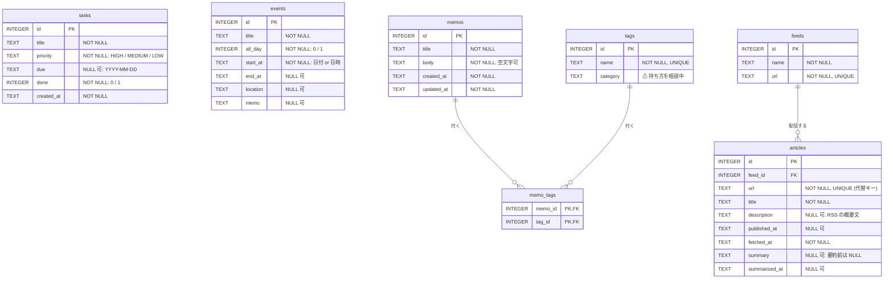

# ER 図(⚠ 案 — 一部相談中)

ドメインモデル(`src/pda/domain/`)から起こした SQLite のテーブル案。
SQLite には日付型がないので、日付・日時は ISO 8601 の TEXT(`2026-11-15` / `2026-11-15T09:00:00`)で持つ。

## 関係の読み方
| 関係 | 多重度 | 意味 |
|---|---|---|
| memos — tags | 多対多(`memo_tags` 経由) | 1 つのメモに複数のタグ、1 つのタグは複数のメモに付く |
| feeds — articles | 1 対多 | 1 つのフィードが複数の記事を配信する。記事は必ずどれか 1 つのフィードから来る |
| tasks / events | 他と関係なし | 単独のテーブル |

## 決定事項(2026-11-15)
1. **events は 1 テーブル**。`all_day` で終日か時刻付きかを区別し、`start_at` / `end_at` の形式は CHECK 制約で縛る
2. **tags は別テーブル**。理由: タグ名の変更が 1 行で済む・タグ自体に属性を足せる。カテゴリーを持たせる(持ち方は相談中)
3. **tasks の登録順は `created_at`**。同じ日時どうしは `id` 順
4. **要約は articles の列**(`summary`, `summarized_at`)。モックか本物かは記録しない。理由: その区別が役立つのは切り替え時だけで、常設すると重くなる
   - 本物の要約器へ切り替えるときは、既存のモック要約を消して作り直す(`UPDATE articles SET summary = NULL, summarized_at = NULL;`)
5. ニュース側(feeds / articles)はドメイン未設計の仮置き。ニュースのドメインを決めたら見直す

## 正規化メモ
- `articles` では `id` も `url` も候補キー(`url` は UNIQUE)。`url → title` などの関数従属は成り立つが、決定項 `url` が超キーなので BCNF に違反しない。主キーには短い代理キー `id` を選び、`url` は代替キーとして UNIQUE で表す
- フィード名を `articles` に持たせると `id → feed_id → feed名` の推移的従属になり 3NF 違反。だから `feeds` を分けている
- `memo_tags(memo_id, tag_name)` だけでも BCNF(全属性がキー)。tags を分けたのは正規化ではなく運用上の理由(上の 2)
