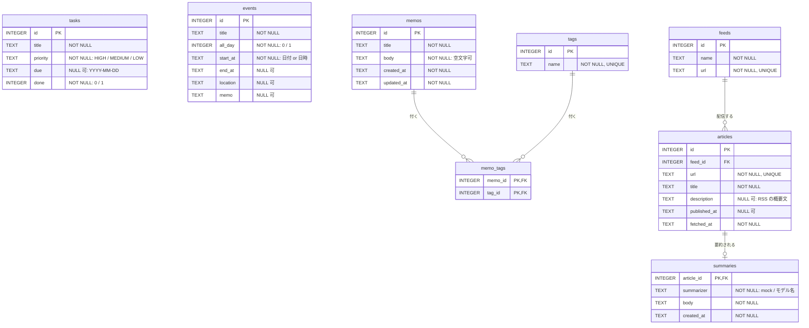

# ER 図(⚠ 案 — ユーザーと相談中)

ドメインモデル(`src/pda/domain/`)から起こした SQLite のテーブル案。
SQLite には日付型がないので、日付・日時は ISO 8601 の TEXT(`2026-11-15` / `2026-11-15T09:00:00`)で持つ。

## 関係の読み方
| 関係 | 多重度 | 意味 |
|---|---|---|
| memos — tags | 多対多(`memo_tags` 経由) | 1 つのメモに複数のタグ、1 つのタグは複数のメモに付く |
| feeds — articles | 1 対多 | 1 つのフィードが複数の記事を配信する。記事は必ずどれか 1 つのフィードから来る |
| articles — summaries | 1 対 0..1 | 記事は要約される前は要約を持たない。要約は 1 記事に最大 1 つ |
| tasks / events | 他と関係なし | 単独のテーブル |

## 相談したい設計判断
1. **events を 1 テーブルにするか 2 テーブルにするか**: 案は 1 テーブル + `all_day` フラグ。`start_at` が日付か日時かは `all_day` で決まるので、CHECK 制約で形式を縛る
2. **tags を別テーブルにするか**: `memo_tags(memo_id, tag_name)` だけでも正規形の上では問題ない(全属性がキーなので BCNF)。別テーブルにする理由は、タグ名の変更が 1 行で済むこと・タグ自体に属性(色など)を足せること
3. **tasks の「登録順」**: `id`(自動採番で単調増加)の順を登録順とみなす案。作成日時の列を足す案もある
4. **summaries を articles と分けるか**: 要約を articles の列にしても、要約は記事のキーだけに従属するので正規形は崩れない。分ける理由は、要約前の記事に NULL の列を持たせないこと・どの要約器(mock かモデル名か)で作ったかを一緒に残せること
5. **ニュース側(feeds / articles / summaries)はドメイン未設計の仮置き**。ニュースのドメインを決めたら見直す
